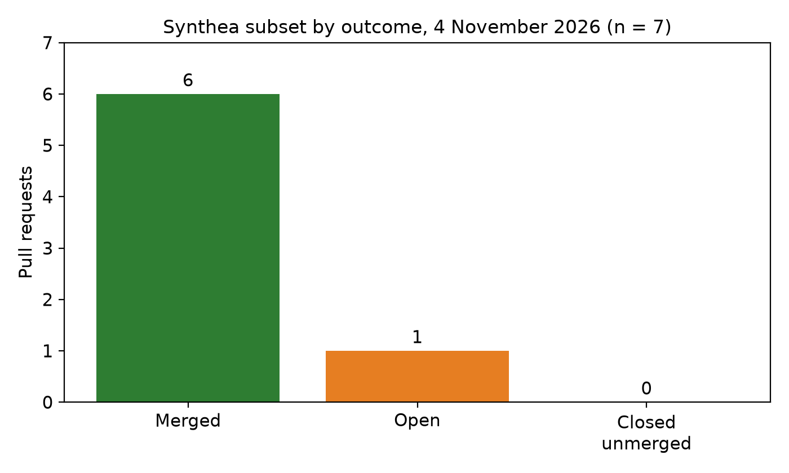
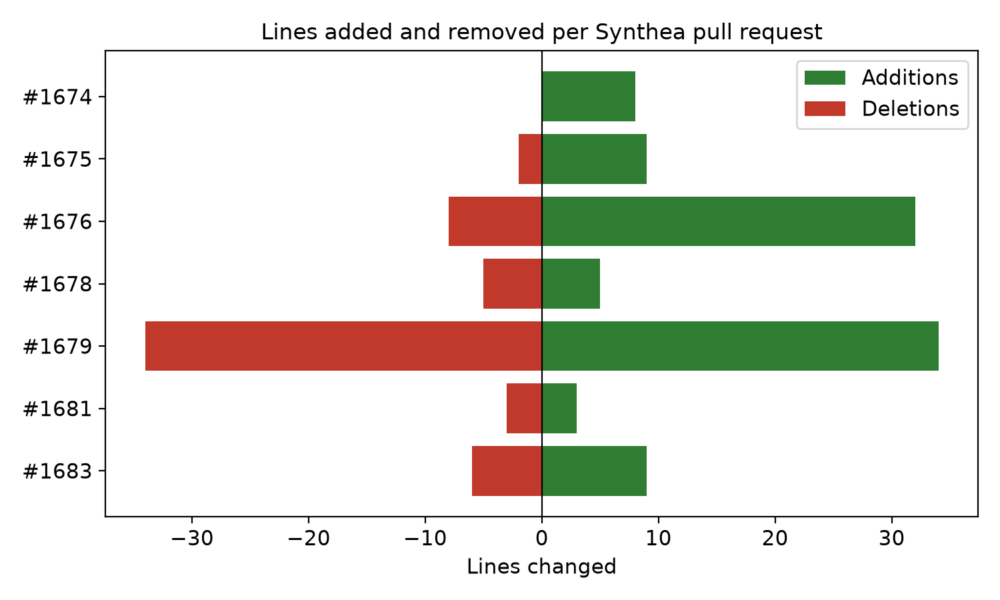
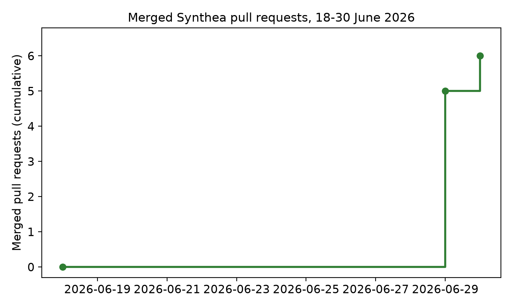

## Download the paper (PDF)

[](https://github.com/rtmalikian/synthetic-patients-synthea-what-they-teach/raw/main/week4-synthetic-patients.pdf)

### 👉 [**Click here to download the PDF**](https://github.com/rtmalikian/synthetic-patients-synthea-what-they-teach/raw/main/week4-synthetic-patients.pdf)

One click, no sign-up, no paywall.

---

# Synthetic Patients and What They Can and Cannot Teach: A Retrospective Analysis of Open-Source Contributions to Synthea

Raphael T. Malikian, MBBS BSc (Hons) — Independent Researcher, Palmdale, California, USA — ORCID 0009-0008-4326-4205

Preprint: Zenodo, https://doi.org/10.5281/zenodo.23964017. Journal submission in preparation.

**Key numbers:** 7 pull requests to [synthetichealth/synthea](https://github.com/synthetichealth/synthea), 6 merged, 1 open, 0 closed unmerged (100% merge share among resolved PRs). 100 additions, 58 deletions, 20 changed files. Extracted from the GitHub API on 4 November 2026.

---

**Running head:** SYNTHETIC PATIENTS AND WHAT THEY CAN AND CANNOT TEACH

**Author:** Raphael T. Malikian, MBBS BSc (Hons)

**Affiliation:** Independent Researcher, Palmdale, California, USA

**Corresponding author:** Raphael T. Malikian. Email: rtmalikian@gmail.com. GitHub: github.com/rtmalikian

**ORCID:** 0009-0008-4326-4205

**Article type:** Retrospective observational study with reflective practice analysis

**Keywords:** synthetic data; Synthea; electronic health records; FHIR; data quality; open-source software; pull requests; clinical AI

**Author background, in brief.** The author trained in medicine in the United Kingdom and completed family medicine residency training in the United States. He later bootstrapped a direct primary care clinic and ran it as chief executive. He now builds clinical artificial intelligence tools and contributes code to open-source health and AI projects. His earlier peer-reviewed work includes a four-station knee simulator study published in 2013 [14]. This paper covers the synthetic patient layer underneath clinical AI: the generated records that developers test on, train on, and trust before any real chart is involved.

---

## Abstract

**Background.** Real patient records sit behind privacy law and institutional review, and they should. Synthetic patients fill the gap. Synthea generates synthetic patients with plausible histories and exports them in formats that include FHIR, so developers can build and test without touching a real chart. That bargain holds only if the synthetic data is realistic in the ways that matter downstream.

**Purpose.** This study describes one contributor's pull requests (PRs) to Synthea, reports what merged and what did not, and asks what the pattern says about what synthetic patients can teach and what they cannot.

**Methods.** The data source was the author's public GitHub record, extracted with the GitHub REST API on 4 November 2026 (search: author:rtmalikian, type:pr). The full record held 233 PRs. This paper analyses the Synthea subset: 7 PRs in 1 repository, synthetichealth/synthea. Each PR was classed as merged, open, or closed unmerged. All 7 PRs were read in full, including their public descriptions and changed files.

**Results.** Six of the 7 subset PRs merged, 1 remained open, and none closed unmerged. Among the 6 resolved PRs, the merge share was 100%. The merged work fixed a claim total that did not equal the sum of its items, a laboratory reference range copied from the wrong measurement (platelet distribution width set to 150 to 520 instead of 9 to 17 fL, corrected in 9 module files), a null-unsafe comparison that could kill a FHIR export run, a file stream left open, string comparisons by identity instead of content, and undocumented configuration precedence. The open PR addresses duplicate primary keys in claim transaction exports at scale, reported with 10,000 patients and again with 1,000,000 patients.

**Conclusions.** Synthetic patients teach pipeline shape, export format, and billing arithmetic well. They teach clinical outcomes badly. The validation literature found Synthea modelling demographics and service probabilities reliably while returning zero complications after hip and knee replacement and zero controlled blood pressures after hypertension diagnosis, against real rates near 3% and 70%. The cases in this paper point the same way from inside the generator: errors in constants, arithmetic, identity, and export code propagate into every dataset the generator produces. A synthetic dataset deserves the same realism audit that a real dataset gets for completeness and correctness, applied at the generator, before anyone trains on it.

---

## 1. Introduction

A developer who needs patient records for testing has two bad options and one good one. Real records are protected, and getting them takes approvals, agreements, and time. Handmade test fixtures are small, tidy, and unrepresentative. Synthetic patients are the good option in between: generated records that look like real records in shape, coded in the same vocabularies, exported in the same formats, with no real person behind any row.

Synthea is the best known open generator in this space. Walonoski and colleagues built it to produce synthetic patients with plausible histories, driven by disease modules written from published clinical knowledge, and to export the result as a synthetic electronic health record [1]. A team can generate a population, load it into a FHIR server, test a billing pipeline, or train a model, all without a data use agreement. That is a large freedom, and it carries a matching risk. A generated dataset that looks right in shape can still be wrong in sense, and the wrongness propagates silently into everything built on it.

The validation literature already drew this line. Chen and colleagues took a 1.2 million person Synthea population for Massachusetts and calculated four clinical quality measures from it, then compared the results with publicly reported real rates [2]. The generator did well on demographics and on the probability that a service is offered. It did badly on outcomes after care. Colorectal cancer screening came out at 63% against 77.3% in Massachusetts and 69.8% nationally, a gap, but a recognisable one. COPD 30-day mortality came out at 0.7% against 7% in Massachusetts and 8% nationally. Complications after hip and knee replacement came out at zero against 2.9% and 2.8%. Controlled blood pressure after hypertension diagnosis came out at zero against 74.52% and 69.7%. Chen and colleagues concluded that Synthea models care processes after clinical guidelines, which describe what ideally should happen, while quality measures spotlight suboptimal care, and that generators do not yet model deviations in care and the outcomes that follow from them [2]. That finding is the frame for this paper.

Data quality language gives the same warning a second vocabulary. Kahn and colleagues built a shared terminology for secondary use of health record data, with correctness named as its own dimension [3]. Weiskopf and Weng separated completeness from correctness: a dataset can be complete and still wrong [4]. A synthetic dataset is complete by construction. Every field is filled, every record is present, every export runs. Correctness is the dimension that has to be checked by hand, constant by constant, and the cases in this paper are what that checking looks like from inside one generator.

### 1.1 Purpose of the Paper

Papers in this series divide one contributor's record by domain. Earlier papers covered clinical natural language processing, medical imaging, vector databases and retrieval, FHIR and clinical data infrastructure, and LLM tooling and agent infrastructure. The FHIR paper covered Synthea as one part of a 52 PR subset. This paper is the deep dive that the queue promised for Week 4: the same Synthea work, read in full, with the changed files named and the failure shapes drawn out. The Synthea subset is unchanged since the October extraction. No new Synthea PRs appeared between 21 October and 4 November 2026, so this paper re-extracts and re-verifies the same 7 PRs rather than reporting new ones. That stability is itself a finding about where this contributor's Synthea work stands.

The paper asks three questions.

**RQ1.** What did the 7 Synthea contributions actually fix, stated in operational terms, and what do the changed files show about where synthetic data breaks?

**RQ2.** What does a 100% merge share among resolved PRs mean here, and what does the one open PR, about duplicate keys at scale, say about the limits of that reading?

**RQ3.** What can synthetic patients teach, what can they not teach, and what check should a team run before trusting a generated dataset for a given use?

## 2. Methods

### 2.1 Data source and extraction

Data came from the GitHub REST API search endpoint on 4 November 2026, using the query `author:rtmalikian type:pr`. The search returned a total count of 233 PRs in the author's public record. The Synthea search, restricted to synthetichealth/synthea, returned 7 PRs. Repository names, PR numbers, titles, states, and merge or closure dates came from the API response, and each PR in the subset was then fetched individually to confirm its merged flag, addition and deletion counts, and changed-file counts, and to list the changed files. PR descriptions quoted or paraphrased in Section 3.2 come from the public PR pages themselves. Any reader can repeat the search and compare counts.

### 2.2 Subset definition

The subset was defined by repository before any counting. A PR entered the subset if its target repository was synthetichealth/synthea, the synthetic patient generator. One repository met the rule. The subset held 7 PRs. Clinical text processing, imaging, retrieval, FHIR server work, and agent tooling fall outside the rule and appear in the other papers of this series.

### 2.3 Status definitions

A PR was coded **merged** if the API recorded a merge timestamp, **closed unmerged** if its state was closed with no merge timestamp, and **open** if it was open at extraction. The merge share among resolved PRs is merged divided by merged plus closed unmerged. Open PRs are excluded from that share, and the paper says so wherever the number appears. An open PR is a censored observation. It may merge next week.

### 2.4 Case selection

All 7 PRs were read in full. There was no sampling, and no PR was dropped for being inconvenient. Section 3.2 groups the cases by failure shape rather than by PR number, because the same shape appears in more than one change. The open PR gets the same treatment as the merged ones. A results section that reports only wins would teach nothing.

### 2.5 Contribution workflow under study

The workflow behind these PRs was fixed in advance. The defect had to be reproduced locally before a fix was written. Tests had to pass locally before the PR opened. The repository's own PR template outranked the author's habits. Every commit carried a Developer Certificate of Origin sign-off. Corrections went in as new commits on the same branch; history was never rewritten by force-push. When a maintainer request could be read two ways, the author asked one clarifying question and waited.

### 2.6 Ethics

This study used public software records only. It involved no patient data, no clinical records, and no private messages. The one dataset discussed at length, Synthea output, is synthetic by design: the generator invents its patients [1]. Reporting follows the spirit of the STROBE and RECORD statements for observational work on routinely collected data [12, 13].

## 3. Results

### 3.1 The subset in numbers

The subset held 7 PRs in 1 repository. Six merged (85.7% of the subset), 1 was open at extraction (14.3%), and none had closed unmerged. Among the 6 resolved PRs, the merge share was 100%. Across the subset, the PRs added 100 lines and removed 58 lines across 20 changed files. Creation dates ran from 18 to 19 June 2026, and merged dates from 29 to 30 June 2026: five merges on 29 June, one on 30 June. Table 1 lists every PR. Figure 1 shows the outcome split. Figure 2 shows lines changed per PR. Figure 3 shows merges accumulating across the two merge days.

The small size is the point of a deep dive. Seven PRs, 158 lines changed in total, touched the claim export, the FHIR exporters, the cost code, the state engine, the CPCDS exporter, the birth statistics code, the flexporter mapping code, one application file, and nine disease module files. A synthetic patient generator is a small number of constants and export paths away from a wrong dataset. Every case below is small. Every case below would have reached every generated patient.

**Table 1.** All pull requests in the Synthea subset, by number, title, status, and size, at 4 November 2026.

| PR | Title (short) | Status | Added | Removed | Files |
|---:|---|---:|---:|---:|---:|
| 1674 | Document argument order precedence for -c and --config flags | Merged 29 Jun 2026 | 8 | 0 | 1 |
| 1675 | MD5-based UUID for ClaimTransaction IDs to prevent duplicate primary keys | Open | 9 | 2 | 1 |
| 1676 | Set Claim.total to sum of item.net values in FHIR exports | Merged 30 Jun 2026 | 32 | 8 | 3 |
| 1678 | Use .equals() instead of == for String comparisons | Merged 29 Jun 2026 | 5 | 5 | 3 |
| 1679 | Correct PDW lab value range from 150-520 to 9-17 fL | Merged 29 Jun 2026 | 34 | 34 | 9 |
| 1681 | Null-safe String comparison for observation.category in FhirR4 | Merged 29 Jun 2026 | 3 | 3 | 1 |
| 1683 | Close FileInputStream in Mapping.parseMapping() via try-with-resources | Merged 29 Jun 2026 | 9 | 6 | 2 |
| **Total** | | **6 merged, 1 open** | **100** | **58** | **20** |

**Figure 1.** Pull requests by outcome at 4 November 2026. Six merged, one open, none closed unmerged.



**Figure 2.** Lines added and removed per Synthea pull request. The largest change is the laboratory range correction, which touches nine module files with equal additions and deletions.



**Figure 3.** Cumulative merged pull requests, 18 to 30 June 2026. Five merges landed on 29 June and the sixth on 30 June, eleven days after the last PR in the subset was created.



**Table 2.** Chen and colleagues' validation of a 1.2 million person Synthea population against publicly reported real rates [2]. Synthetic rates are quoted from that study, not measured in this paper.

| Quality measure | Synthetic rate | Massachusetts real rate | United States real rate |
|---|---:|---:|---:|
| Colorectal cancer screening, compliant | 63% | 77.3% | 69.8% |
| COPD 30-day mortality | 0.7% | 7% | 8% |
| Complications after hip/knee replacement | 0% | 2.9% | 2.8% |
| Controlled blood pressure after hypertension diagnosis | 0% | 74.52% | 69.7% |

### 3.2 Case studies

#### 3.2.1 Arithmetic that has to be right: claim totals and a copied laboratory range

PR #1676 is the clearest case in the subset. The FHIR R4 definition of Claim.total states that the total is the sum of the item.net values for all claim items. Synthea's export broke that rule twice over. The encounter item itself was added to the claim without a net value, even though the encounter cost was included in the total. And the total was computed after adjustments in one place and before them in another, so the two figures disagreed. The fix, across FhirR4.java, FhirStu3.java, and Costs.java, sets Claim.total to the sum of item.net values. A generated claim now adds up the way a real claim must.

The downstream point is direct. Teams train models and test billing logic on Synthea output. A dataset whose claims contradict themselves teaches every consumer to tolerate contradiction. A billing pipeline tested against self-contradictory claims passes tests it should fail, and a model trained on those claims learns that totals and items need not agree. The fix is 32 lines added and 8 removed. Its value sits in every generated claim after it.

PR #1679 is the case I would put first if I had to pick one. Synthea generated platelet distribution width values against a reference range of 150 to 520. That range belongs to a platelet count. Platelet distribution width is measured in femtolitres, and its range sits near 9 to 17 fL. The PR description states that the wrong values appear to have been copied from the adjacent platelet count observation, which carries a range of 150 to 450 in its own units. The correction touches nine module files: anemia, bone marrow transplant, colorectal cancer, HIV baseline, kidney transplant, lung cancer, urinary tract infection, veteran prostate cancer, and wellness encounters. The change is 34 lines added and 34 removed, a constant swapped in nine places.

Nobody had noticed, because synthetic data gets checked for shape more than for sense. A validator confirms that the value sits inside the stated range. The stated range was wrong, so every generated value passed validation and was still wrong. A clinician reading the fixture would catch it at a glance. A pipeline reading the fixture would not. That asymmetry is the whole argument for a realism audit at the generator: schema validation cannot catch a constant that is wrong in the right format.

#### 3.2.2 Scale breaks identity: the open PR on duplicate primary keys

PR #1675 is still open at extraction, and it is the most consequential PR in the subset. ClaimTransaction IDs in the CSV export were generated with a helper that relies on String.hashCode, a 32-bit integer, to differentiate keys. When many claim transactions share the same person seed and encounter start timestamp, hash collisions produce duplicate primary keys. The PR description reports the failure at two scales: 2 duplicate IDs found with 10,000 patients, and duplicates across imaging_studies, claims_transactions, claims, and encounters tables with 1,000,000 patients. The proposed fix, in CSVExporter.java, uses an MD5-based UUID for ClaimTransaction IDs.

Read this against Chen and colleagues' validation [2]. Their population was 1,193,439 synthetic residents. At that scale, the duplicate key failure is not an edge case. It is the normal operating size of a Synthea population used for validation. A dataset with duplicate primary keys breaks joins, double counts transactions, and silently drops rows on load into any store that enforces uniqueness. The failure mode is also the quiet kind this series keeps finding: the export runs, the files look complete, and the damage appears only when a consumer enforces a constraint the generator never checked.

The open state matters for RQ2. If #1675 merges, the subset merge share stays at 100% among resolved PRs, now 7 of 7. If it closes unmerged, the share falls to 85.7%. Either way, the defect it names is real at the scales Synthea is actually used at, and the paper's claim about scale does not depend on the PR's fate. Open is a review state, not a quality verdict.

#### 3.2.3 Export code that must not crash or leak

Three merged PRs are export hygiene, and together they describe what a generator owes its consumers. PR #1681 fixes null-unsafe comparisons in FhirR4.java: the exporter called observation.category.equals and equalsIgnoreCase without null guards, while code a few lines later already checked for null before using the same field in a switch statement. One missing field could throw a NullPointerException and kill an export run. The PR description links the failure to a reported crash at FhirR4.observation when using US Core 3.1. The fix is 3 lines added and 3 removed.

PR #1683 closes a file stream that the flexporter mapping code left open. Mapping.parseMapping created a FileInputStream, handed it to a YAML loader that reads but does not close it, and returned. The descriptor stayed open until garbage collection finalised the stream, which is non-deterministic. Under heavy load, with many flexporter mappings loaded in sequence, open descriptors accumulate. The fix uses try-with-resources, with a test added in ActionsTest.java. A resource leak in a generator is a slow failure: the first thousand patients export fine, and the failure arrives at a scale no small test reaches.

PR #1678 fixes string comparisons by identity in three files: State.java, CPCDSExporter.java, and BirthStatistics.java. Java's == on strings compares object references, not content, and works by coincidence when literals are interned. The fix replaces the comparisons with .equals calls. A comparison that works by coincidence is a defect with a delay attached. It passes every test written against literals and fails on the first string built at runtime.

These three PRs share one lesson. A generator owes its users the data, plus an export that finishes, does not leak resources while finishing, and compares content as content. A synthetic dataset that cannot be generated at scale, or that crashes on a missing field, teaches nothing at all.

#### 3.2.4 Documentation as an interface

PR #1674 documents argument order precedence for the -c config file flag and the --config command line overrides in App.java. Both write to the same Properties object, and the last one in the argument list wins. That behaviour was not in the help text. The fix adds a note with concrete examples showing both orderings and which value wins. It is 8 lines added, no lines removed, and it is the smallest PR in the subset.

Small does not mean trivial. A generator is a tool that other people run with their own configurations. Undocumented precedence is a silent override: a user sets a value in a config file, overrides it on the command line in the wrong order, and generates a population under settings they did not intend. The generated data is then wrong for a reason no one can see in the data itself. Documentation of precedence is part of the data's provenance, and provenance is part of the data.

## 4. Discussion

### 4.1 What synthetic patients can teach

Synthetic patients teach pipeline shape well. A FHIR server can be loaded, a query can be run, a billing pipeline can be exercised end to end, and a model can be trained on data shaped like real records, all without a data use agreement. They teach export format: whether a consumer reads Claim, Observation, Encounter, and Condition resources as the generator writes them. They teach arithmetic shape, once #1676 lands: totals that equal their items. They teach scale behaviour, once #1675 lands: keys that stay unique at a million patients. And they teach configuration behaviour, once #1674 lands: settings that mean what the help text says they mean.

The bold claim this paper will make, tied to its numbers, is this: for pipeline testing, a generated dataset is not a weak substitute for real data. It is the better test, because it can be generated at any scale, with known ground truth about what was intended, and re-generated after a fix to prove the fix worked. The 100% merge share among resolved PRs in this subset, 6 of 6, backs a narrower version of that claim: maintainers of the leading synthetic patient generator accepted every resolved correction sent to it in this window, including corrections to its arithmetic and its constants.

### 4.2 What synthetic patients cannot teach

Synthetic patients cannot teach clinical outcomes, and the evidence for that limit is not anecdotal. Chen and colleagues found zero complications after hip and knee replacement and zero controlled blood pressures in a 1.2 million person synthetic population, against real rates near 3% and 70% [2]. Those are not small gaps. They are absences. A model trained on that population learns that joint replacement never has complications and that hypertension is never controlled. A study that measures an intervention's effect on those outcomes with that population measures nothing real.

The mechanism is plain. Synthea models care processes after clinical guidelines, and guidelines describe what ideally should happen [2]. Real care deviates: clinicians vary, patients do not follow plans, complications happen, follow-up fails. A generator that models the guideline without modelling deviation produces ideal care at scale, and ideal care is the wrong teacher for outcomes. The same mechanism explains the PDW case from inside the generator. A module constant copied from the wrong measurement produces wrong data at scale, and no validator catches it, because the data is well formed. Well formed is not the same as true.

Three further limits follow. First, synthetic patients cannot teach clinician judgment, because no clinician exercised any. The generator's decisions are the module author's decisions, encoded in advance. Second, they cannot teach rare-event rates, because rare events in a generator happen at the rate the module author set, not at the rate the world produces. Third, they cannot teach the mess of real records: missing fields, conflicting entries, and delayed documentation. Synthea can simulate a missing field, as #1681 shows by crashing on one, but a simulated gap is a chosen gap. Real gaps are unchosen, and that difference matters for any model that must handle them.

### 4.3 Why the merge share ran high, and why that reading needs care

The 100% merge share among resolved PRs is the highest in this series, and the reason is visible in Table 1. The subset is one project, one maintainer team, and seven small, concrete, reproduction-backed fixes. Open-source review research describes pull-based development as a process where maintainers weigh technical quality beside social signals [5, 6], and where contributors report slow or absent feedback as a real barrier [7, 8]. Nothing in this subset shows that barrier. Five merges landed on a single day, 29 June 2026, eleven days after the last PR was created. Small fixes with named root causes and bounded changes are the easiest changes for a maintainer to say yes to, and these seven fit that shape.

Three cautions apply. First, the subset is tiny. One open PR is 14.3% of it, and its resolution will move the final share to 100% or to 85.7%. Second, merged is not the same as used. This study did not track whether merged fixes reached a tagged release or changed any running generator. The honest claim is narrower: in this window, in this project, small fixes to synthetic data correctness were accepted at a high rate. Third, the author is also the subject, which cuts both ways: he has the thread history and the motives, and he has an interest in his own record. The counts are platform facts and can be checked by any reader. The explanations in Sections 4.1 and 4.2 cannot be checked the same way, and they should be weighted as interpretation.

### 4.4 A realism audit before trusting a generated dataset

Table 3 turns the cases into a check a team can run before using a generated dataset for a given purpose. The check is deliberately dull. It asks whether the dataset's arithmetic adds up, whether its laboratory ranges and units match published ranges, whether its keys stay unique at the scale the team will actually use, whether its export survives missing fields, whether its configuration precedence is documented, and whether its outcome rates resemble real rates for the measures the team cares about. A dataset that passes the shape checks and fails the outcome checks is still useful for pipeline testing. It is not useful for outcome research, and the paper's position is that the distinction should be stated in any study that uses it.

**Table 3.** Realism audit for a generated dataset, drawn from the Synthea cases in this paper and the validation measures in Chen and colleagues [2].

| Check | Question to ask | Case that motivates it |
|---|---|---|
| Arithmetic | Do totals equal the sum of their items? | PR #1676, Claim.total |
| Constants and units | Do laboratory ranges and units match the measurement, not a neighbouring one? | PR #1679, PDW range in 9 modules |
| Identity at scale | Do primary keys stay unique at the population size you will actually generate? | PR #1675, duplicate keys at 10,000 and 1,000,000 patients |
| Export survival | Does export survive a missing field without crashing? | PR #1681, null observation.category |
| Resource handling | Does generation at scale leak resources? | PR #1683, unclosed FileInputStream |
| Comparison meaning | Do comparisons test content, not object identity? | PR #1678, == on strings |
| Configuration provenance | Is setting precedence documented, so a generated population means what its settings say? | PR #1674, -c and --config precedence |
| Outcome resemblance | Do outcome rates for your measures resemble real rates, or are they zero where real rates are not? | Chen and colleagues [2], complications and blood pressure control at 0% |

The audit also answers RQ3 directly. A team that runs it can say, in one paragraph, what its generated dataset is good for and what it is not good for. That paragraph belongs in the methods of any paper that trains or tests on synthetic patients. Without it, a reader cannot tell whether a result is a finding about medicine or a finding about the generator.

### 4.5 Limits

This is one contributor, one project, one extraction date. The author is also the subject. The subset covers seven PRs chosen by repository, not by sampling, so nothing here generalises to synthetic data generators as a whole. The paper makes no claim about patient outcomes. No clinical deployment was studied, and no real patient data was used. The validation figures in Table 2 come from Chen and colleagues [2], not from this study, and the clinical reading in Section 4.2 is an implication for builders, not evidence from a trial. Machine learning systems carry technical debt in the code around the model, the data pipelines, and the configuration [9, 10], and a synthetic data generator is almost entirely that surrounding system. That is why its small defects matter as much as they do.

## 5. Conclusions

Synthetic patients are a good tool with a sharp edge. They let developers build, test, and train without touching a real chart, and the generator in this study accepted every resolved correction sent to it in this window. The corrections themselves show where the edge sits. A claim total that does not add up, a laboratory range copied from the wrong measurement, duplicate keys at a million patients, an export that crashes on a missing field, a stream left open, a comparison that tests identity instead of content: each of these is small, each of these reached every generated patient, and each of these was fixed by making the code say what it actually did.

The limit is just as clear. A generator that models guidelines models ideal care, and ideal care teaches outcomes badly. Zero complications and zero controlled blood pressures in a population of 1.2 million are not rounding errors. They are the signature of a generator that has not modelled deviation, and any outcome study built on that population inherits the signature. Use synthetic patients for pipelines, formats, arithmetic, and scale. Do not use them as evidence about what happens to real patients after care, until the generator has earned that use with a realism audit.

I keep contributing to this layer anyway. Real records will stay protected, and they should. Synthetic patients are the only way most developers will ever test at scale, and the generator deserves the same care that a real dataset gets for correctness. Work that lands there stays landed, in every population generated after it.

### 5.1 Future Work

Three follow-ups are practical. The first is a realism audit at scale, as proposed in the FHIR paper and sharpened here: a systematic check of laboratory reference ranges and unit constants across Synthea's modules, compared against published ranges, reporting how common the PDW class of error is. The audit method is dull. The findings would not be.

The second is a release-tracking study. Merged is not used, and the next step is to follow each merged fix in this subset into a tagged Synthea release, then check whether downstream populations, including SyntheticMass-scale cohorts, were generated from a release that includes the fix. A fix that merges but never ships helps no user, and the gap between merge and release is a measurable part of the pipeline.

The third is a prospective outcome comparison. Generate a fresh Synthea population from a current release, calculate the four quality measures from Chen and colleagues [2] again, and report whether the gaps have narrowed since 2019. If complications and blood pressure control are still zero, the field has a precise statement of what remains unmodelled. If they have moved, the field has a measure of progress that is not a claim about a model.

## Declarations

**Funding.** None. This work received no grant or sponsor support.

**Conflicts of interest.** The author declares no conflicts of interest and no industry affiliations of any kind. The author is an independent researcher.

**Data availability.** Every pull request analysed here is public at github.com/rtmalikian. A snapshot of the dataset extracted on 4 November 2026, with repository names, PR numbers, states, and merge or closure dates, is deposited with the published version of this paper.

**Ethics.** This study is not human-subjects research. It used public software records only and involved no patient data.

**AI assistance.** An AI tool was used for literature searching, drafting support, and editing. The author reviewed the full text, verified the counts against the GitHub API extraction of 4 November 2026, and takes full responsibility for the content.

**Author contributions.** The author designed the study, extracted and coded the data, selected the cases, and wrote the paper.

## References

1. Walonoski J, Kramer M, Nichols J, Quina A, Moesel C, Hall D, et al. Synthea: an approach, method, and software mechanism for generating synthetic patients and the synthetic electronic health care record. J Am Med Inform Assoc. 2018;25(3):230-238.
2. Chen J, Chun D, Patel M, Chiang E, James J. The validity of synthetic clinical data: a validation study of a leading synthetic data generator (Synthea) using clinical quality measures. BMC Med Inform Decis Mak. 2019;19:44.
3. Kahn MG, Callahan TJ, Barnard J, Bauck AE, Brown J, Davidson BN, et al. A harmonized data quality assessment terminology and framework for the secondary use of electronic health record data. EGEMS (Wash DC). 2016;4(1):1244.
4. Weiskopf NG, Weng C. Methods and dimensions of electronic health record data quality assessment: enabling reuse in translational informatics. J Am Med Inform Assoc. 2013;20(1):144-151.
5. Gousios G, Pinzger M, van Deursen A. An exploratory study of the pull-based software development model. In: Proceedings of the 36th International Conference on Software Engineering (ICSE 2014). New York: ACM; 2014. p. 345-355.
6. Tsay J, Dabbish L, Herbsleb J. Influence of social and technical factors for evaluating contribution in GitHub. In: Proceedings of the 36th International Conference on Software Engineering (ICSE 2014). New York: ACM; 2014. p. 356-366.
7. Gousios G, Zaidman A, Storey MA, van Deursen A. Work practices and challenges in pull-based development: the contributor's perspective. In: Proceedings of the 38th International Conference on Software Engineering (ICSE 2016). New York: ACM; 2016. p. 285-296.
8. Steinmacher I, Silva MAG, Gerosa MA, Redmiles DF. A systematic literature review on the offerings of newcomers to open source software projects. Inf Softw Technol. 2015;59:412-422.
9. Sculley D, Holt G, Golovin D, Davydov E, Phillips T, Ebner D, et al. Hidden technical debt in machine learning systems. In: Advances in Neural Information Processing Systems 28 (NeurIPS 2015). Montreal: Curran Associates; 2015. p. 2503-2511.
10. Amershi S, Begel A, Bird C, DeLine R, Gall H, Kamar E, et al. Software engineering for machine learning: a case study. In: Proceedings of the 41st International Conference on Software Engineering: Software Engineering in Practice (ICSE-SEIP 2019). Montreal: IEEE/ACM; 2019. p. 291-300.
11. Johnson AEW, Pollard TJ, Shen L, Lehman LWH, Feng M, Ghassemi M, et al. MIMIC-III, a freely accessible critical care database. Sci Data. 2016;3:160035.
12. von Elm E, Altman DG, Egger M, Pocock SJ, Gotzsche PC, Vandenbroucke JP, et al. The Strengthening the Reporting of Observational Studies in Epidemiology (STROBE) statement: guidelines for reporting observational studies. Lancet. 2007;370(9596):1453-1457.
13. Benchimol EI, Smeeth L, Guttmann A, Harron K, Moher D, Petersen I, et al. The REporting of studies Conducted using Observational Routinely-collected health Data (RECORD) statement. PLoS Med. 2015;12(10):e1001885.
14. Malikian R, et al. Development of a four-station knee wear simulator and preliminary results. J Bioeng Biomed Sci. 2013;3(2). doi:10.4172/2155-9538.1000125.

---

## How to cite

Malikian, R.T. (2026). Synthetic Patients and What They Can and Cannot Teach: A Retrospective Analysis of Open-Source Contributions to Synthea. Zenodo. https://doi.org/10.5281/zenodo.23964017

```bibtex
@misc{malikian2026syntheticpatients,
  author = {Malikian, Raphael T.},
  title = {Synthetic Patients and What They Can and Cannot Teach: A Retrospective Analysis of Open-Source Contributions to Synthea},
  year = {2026},
  publisher = {Zenodo},
  doi = {10.5281/zenodo.23964017},
  url = {https://doi.org/10.5281/zenodo.23964017}
}
```

## Dataset

The dataset for this paper is [week4_pr_dataset.csv](week4_pr_dataset.csv): the 7 pull requests in the Synthea subset (synthetichealth/synthea), extracted from the GitHub API on 4 November 2026, with repository, PR number, title, status, creation and merge or closure dates, comment counts, additions, deletions, changed files, and the PR URL for each record.

## Open-Source Clinical AI Research Series

Part of the Open-Source Clinical AI Research Series by [Raphael T. Malikian](https://github.com/rtmalikian):

- [Clinical NLP and de-identification](https://github.com/rtmalikian/clinical-nlp-deidentification-open-source)
- [Medical imaging and DICOM reliability](https://github.com/rtmalikian/medical-imaging-dicom-open-source-reliability)
- [Vector databases and retrieval for clinical AI](https://github.com/rtmalikian/vector-databases-rag-clinical-ai-infrastructure)
- [FHIR and health data infrastructure](https://github.com/rtmalikian/fhir-health-data-infrastructure-open-source)
- [LLM tooling and agent infrastructure](https://github.com/rtmalikian/llm-tooling-agent-infra-quiet-failures)

---

Raphael Malikian | Clinical AI Architect | Independent Researcher

## Licence

This work is licensed under the Creative Commons Attribution 4.0 International License (CC BY 4.0). You may share and adapt the material for any purpose, including commercial use, provided you give appropriate credit to the author, provide a link to the license, and indicate if changes were made. See the [LICENSE](LICENSE) file. Full license text: https://creativecommons.org/licenses/by/4.0/legalcode
